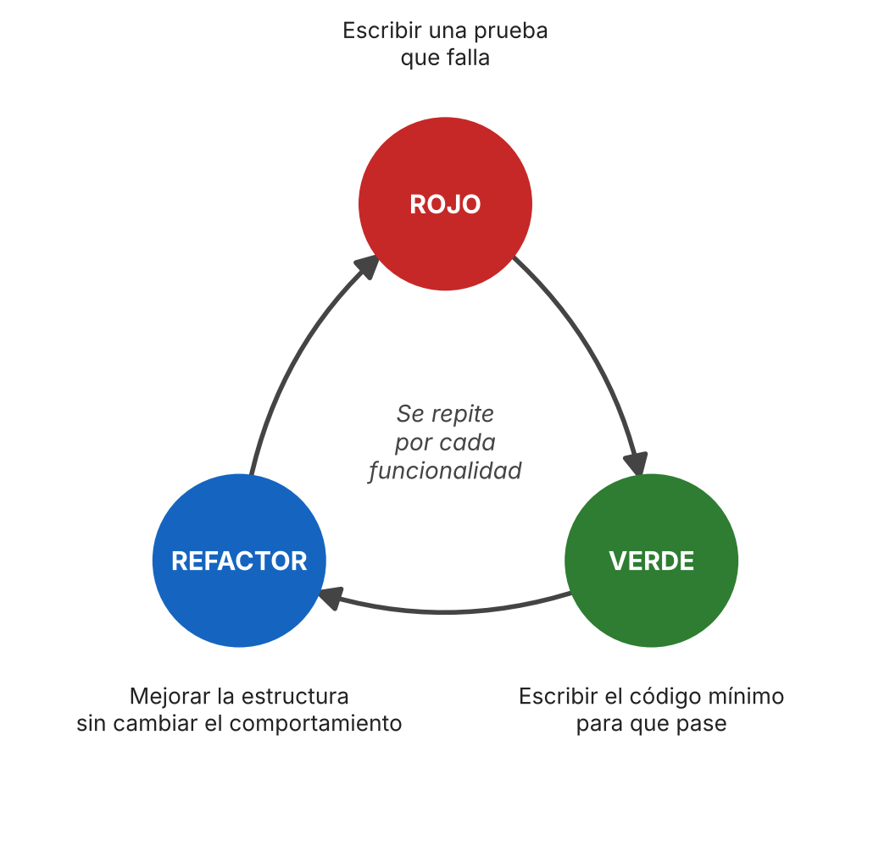

# Anexos

> Tarea 15 · Responsable: Maykel Meoño González · Revisa: Valery Salas Vargas
> Actualizado el 11-nov-2026. Los anexos A y B son copias de `fuentes/matriz-lectura-critica.md` y de la tabla del apartado «Proceso de planificación»: **si esos archivos cambian, hay que volver a copiarlos aquí** y poner el estado final de cada tarea el día de la entrega (regla 5).

## Anexo A. Matriz de lectura crítica

**Tipo de evidencia:**
- **N**: normativa o consenso de un organismo
- **P**: experiencia profesional u opinión experta
- **E**: empírica (estudio con datos)

### Fuente 1 · ISTQB (2024), *Certified Tester Foundation Level syllabus* v4.0.1 · Responsable: Valery

**Ficha general**

| Campo | Contenido |
|---|---|
| Autor / organismo | International Software Testing Qualifications Board, organismo internacional sin fines de lucro que define la certificación de testers |
| Tipo de documento | Programa (*syllabus*) de certificación de nivel básico. El documento se describe así: «This syllabus forms the basis for the International Software Testing Qualification at the Foundation Level» (p. 10) |
| Tipo de evidencia | **N**: consenso de expertos del sector, revisado por los comités nacionales del ISTQB |
| Vigencia | v4.0 del 21-04-2023; v4.0.1 de mantenimiento del 15-09-2024 |
| Acceso | PDF gratuito y oficial en istqb.org |

**Afirmaciones que usa el informe**

| # | Sección (pág.) | Cita textual | Idea en nuestras palabras | Uso en el informe |
|---|---|---|---|---|
| 1 | 1.4.4 (p. 20) | «To implement effective test monitoring and test control, it is important to establish and maintain traceability throughout the test process between the test basis elements…» | La trazabilidad entre la base de prueba (requisitos, criterios) y los casos hace posible controlar las pruebas y saber qué está cubierto. | Desarrollo A: matriz requisito → criterio → caso → resultado |
| 2 | 2.1.3 (p. 26) | TDD: «Directs the coding through test cases (instead of extensive software design)» | En TDD, las pruebas guían la escritura del código, en lugar de un diseño previo extenso. | Introducción; puente con el Desarrollo B |
| 3 | 2.1.3 (p. 26) | «Each of these approaches implements the principle of early testing (see section 1.3) and follows shift left…» | TDD, ATDD y BDD llevan las pruebas a las primeras etapas del desarrollo. | Introducción (contexto); postura sobre TDD |
| 4 | 2.1.3 (p. 26) | ATDD: «Derives tests from acceptance criteria as part of the system design process» | Las pruebas de aceptación se derivan de los criterios de aceptación. | Desarrollo A: del criterio de aceptación al caso |
| 5 | 2.2.1 (p. 28–29) | «Component testing (also known as unit testing) focuses on testing components in isolation.» | La prueba unitaria es la prueba de un componente aislado. | Definición de prueba unitaria; Desarrollo B |
| 6 | 4.2.1 (p. 39) | «Therefore, one test for each partition is sufficient.» | Si los valores de una partición se comportan igual, basta con un caso por partición, válida o inválida. | Desarrollo A: casos normales y de error |
| 7 | 4.2.2 (p. 40) | 2 valores: «for each boundary value there are two coverage items: this boundary value and its closest neighbor»; 3 valores: «…three coverage items: this boundary value and both its neighbors.» | Se prueban los valores en cada frontera de las particiones y sus vecinos. El análisis de 3 valores es más riguroso que el de 2. | Desarrollo A: casos límite del descuento del 10 % |
| 8 | 4.4.1 (p. 43) | «Error guessing is a test technique used to anticipate the occurrence of errors, defects, and failures…» | La experiencia del tester sirve para anticipar errores típicos, como entradas vacías, negativas o con un formato incorrecto. | Desarrollo A: casos de error |
| 9 | 4.5.2 (p. 45–46) | Los criterios de aceptación sirven para «Define the scope of the user story» y «Serve as a basis for the user story acceptance testing» | El criterio de aceptación delimita el requisito y es la base de sus pruebas. | Desarrollo A; preguntas de debate 1 y 2 (ambigüedades) |
| 10 | 4.5.3 (p. 46) | «ATDD is a test-first approach…» | ATDD también escribe las pruebas antes del código, pero en el nivel de aceptación. | Desarrollo A y B (relación entre ATDD y TDD) |

**Valoración crítica**

| | |
|---|---|
| **Fortalezas** | Lo produce un organismo internacional y lo revisan expertos de muchos países. Es el vocabulario estándar del sector, es gratuito y es reciente (2023–2024). Las definiciones son precisas y numeradas, así que se pueden citar con exactitud. |
| **Limitaciones** | Es un programa de certificación: describe y define, pero **no aporta evidencia empírica** sobre si TDD mejora la calidad o la productividad. Presenta TDD de forma neutral y no dice cuándo no conviene. Su objetivo es formar para un examen, por eso simplifica. |
| **Posibles sesgos** | Su interés es promover la certificación y la profesión del tester. Las técnicas que incluye se presentan como buenas prácticas generales, sin considerar el contexto del proyecto. |
| **Qué no puede responder** | Si TDD conviene en *todos* los proyectos. Para eso hacen falta las fuentes de Maykel (Beck o Agile Alliance, Fowler) y, de ser posible, un estudio empírico. |
| **Confiabilidad para el informe** | Alta para definiciones y técnicas de diseño de casos. Baja como argumento a favor o en contra de TDD. |

> Páginas tomadas del índice y de las marcas de página del PDF v4.0.1 (78 p.). **Valery: confirmar cada página con el PDF abierto antes de pasarlas al Word.**

### Fuente 2 · Vocke (2018), *The practical test pyramid* · Responsable: Maykel

**Ficha general**

| Campo | Contenido |
|---|---|
| Autor / organismo | Ham Vocke, ingeniero de software. Publicado en el sitio de Martin Fowler (ThoughtWorks) |
| Tipo de documento | Artículo técnico en línea, 26-feb-2018 |
| Tipo de evidencia | **P**: experiencia profesional, sin datos ni método de investigación |
| Vigencia | 2018. Los principios de las pruebas unitarias no han cambiado, pero los ejemplos de herramientas sí |
| Acceso | Gratuito, https://martinfowler.com/articles/practical-test-pyramid.html |

**Afirmaciones que usa el informe**

| # | Sección | Cita textual | Idea en nuestras palabras | Uso en el informe |
|---|---|---|---|---|
| 1 | Unit tests | «The foundation of your test suite will be made up of unit tests.» | Las pruebas unitarias son la base de la suite. | Desarrollo B: lugar de la prueba unitaria |
| 2 | Test structure | «A good structure for all your tests (this is not limited to unit tests) is this one:» | Una estructura fija de tres partes para toda prueba (⚠ confirmar los nombres de los pasos). | Desarrollo B: AAA |
| 3 | Mocking and Stubbing | «A lot of people use the terms Mock and Stub interchangeably.» | Los dobles de prueba se confunden; hay que definirlos. | Desarrollo B: aislamiento |
| 4 | What to test? | «Don't reflect your internal code structure within your unit tests.» · «Test for observable behaviour instead.» | Probar comportamiento observable evita pruebas frágiles. | Desarrollo B: pruebas frágiles |
| 5 | What to test? | «Look into Test-Driven Development and let your unit tests guide your development» | Recomienda TDD como guía del desarrollo. | Postura sobre TDD |
| 6 | Avoid test duplication | «Every single test in your test suite is additional baggage and doesn't come for free.» | Cada prueba tiene costo de mantenimiento. | Postura sobre TDD (contraargumento) |

**Valoración crítica**

| | |
|---|---|
| **Fortalezas** | Claro, práctico y bien estructurado. Está en un sitio de referencia del sector y es de acceso libre. Cubre justo los temas del Desarrollo B (aislamiento, estructura, fragilidad). |
| **Limitaciones** | Es opinión experta con un solo autor, sin estudios que respalden las recomendaciones. No define el ciclo rojo–verde–refactor ni trata la «falsa sensación de seguridad» con esos términos. Sus ejemplos están en un contexto concreto (microservicios en Java). |
| **Posibles sesgos** | Recomienda TDD sin discutir cuándo no conviene. Parte de la experiencia de un equipo de producto con prácticas ágiles maduras. |
| **Qué no puede responder** | Si TDD mejora la calidad o la productividad con datos. Tampoco dice en qué proyectos no conviene. |
| **Confiabilidad para el informe** | Media-alta para buenas prácticas de pruebas unitarias. Baja como prueba de que TDD «funciona». |

---

### Fuente 3 · Fucci et al. (2017) · Responsables: ambos

**Ficha general**

| Campo | Contenido |
|---|---|
| Autor / organismo | Davide Fucci, Hakan Erdogmus, Burak Turhan, Markku Oivo y Natalia Juristo (investigación académica) |
| Tipo de documento | Artículo científico, *IEEE Transactions on Software Engineering* (2017) |
| Tipo de evidencia | **E**: estudio observacional con datos y regresión múltiple |
| Diseño | 39 profesionales de dos empresas, 82 datos completos, tres tareas (Mars Rover, Bowling Scorekeeper y MusicPhone) |
| Acceso | Preprint gratuito en arXiv (1611.05994); versión publicada por IEEE |

**Afirmaciones que usa el informe** (⚠ las citas salen del preprint de arXiv: confirmar en la versión publicada y anotar página)

| # | Cita textual | Idea en nuestras palabras | Uso en el informe |
|---|---|---|---|
| 1 | «Sequencing, the order in which test and production code are written, had no important influence.» | En el estudio, escribir la prueba antes o después no explicó mejor la calidad ni la productividad. | Postura sobre TDD; contraargumento |
| 2 | «The claimed benefits of TDD may not be due to its distinctive test-first dynamic» | Los beneficios atribuidos a TDD podrían venir de otra parte. | Postura sobre TDD |
| 3 | «TDD-like processes encourage fine-grained, steady steps that improve focus and flow.» | TDD ayuda porque obliga a dar pasos pequeños y parejos. | Postura sobre TDD (cuándo sí) |
| 4 | «we recommend focusing on breaking down development tasks into as small and as uniform steps as possible.» | La recomendación práctica es trabajar en pasos pequeños y uniformes. | Conclusión |

**Valoración crítica**

| | |
|---|---|
| **Fortalezas** | Es la única fuente con datos. Usa profesionales y no solo estudiantes. Mide por separado cuatro factores del proceso (granularidad, uniformidad, orden y esfuerzo de refactor). |
| **Limitaciones** | Sin aleatorización ni grupo de control, así que no prueba causalidad. Muestra por conveniencia, solo dos empresas y tres tareas (dos artificiales) con requisitos fijos. Tareas cortas. Los modelos explican una parte pequeña de la variación (R² ajustado de 0,09 a 0,12). |
| **Posibles sesgos** | Participantes voluntarios o elegidos por sus empresas. Experiencia sesgada hacia perfiles medios y senior. |
| **Qué no puede responder** | El efecto de largo plazo en mantenibilidad, ni el efecto en proyectos grandes con requisitos cambiantes. |
| **Confiabilidad para el informe** | Media: sirve para matizar la postura (el orden test-first no sería lo decisivo), no para generalizar. |

> Nota técnica del propio preprint: el texto llama «positivas» a las asociaciones de granularidad y uniformidad, pero los coeficientes reportados son negativos (ciclos más cortos y parejos se asocian con mejores resultados). Conviene leerlo con cuidado al citar.

## Anexo B. Registro de responsabilidades

Estado de cada tarea al 11 de noviembre de 2026 (el estado final se anota el día de la entrega).

| # | Tarea | Responsable | Revisa | Fecha límite | Estado |
|---|---|---|---|---|---|
| 1 | Buscar y verificar 3 fuentes: ISTQB CTFL v4.0, ISO/IEC/IEEE 29119, Pressman | Valery | Maykel | mar 3 nov | Hecha. Fusionada en `main` |
| 2 | Buscar y verificar 3 fuentes: JUnit 5 User Guide, TDD (Agile Alliance), Vocke *Practical Test Pyramid* | Maykel | Valery | mar 3 nov | Citas contrastadas con los originales en línea el 11-nov. Falta que Maykel abra cada original y confirme Fucci en IEEE Xplore |
| 3 | Metodología (7 pasos, con instrumentos y criterios) | Valery | Maykel | mié 4 nov | Hecha. Fusionada en `main` (PR #1) |
| 4 | Proceso de planificación | Maykel | Valery | mié 4 nov | Hecha (actualizada el 11-nov). Revisión de Valery pendiente |
| 5 | Matriz de lectura crítica | Ambos | Ambos | sáb 7 nov | Las tres fuentes en `main`. Pendiente corregir la sección de la cita 5 de Vocke (fila 5: está en «Mocking and Stubbing») |
| 6 | Introducción | Valery | Maykel | sáb 7 nov | Hecha. Fusionada en `main` (PR #2) |
| 7 | Desarrollo A | Valery | Maykel | lun 9 nov | Hecha. Fusionada en `main` (PR #9). Revisión de Maykel pendiente |
| 8 | Desarrollo B | Maykel | Valery | lun 9 nov | Hecha. Alineada con CP-01 a CP-09; ciclo observado con arnés sin JUnit. Falta correr `mvn test` y la revisión de Valery |
| 9 | Postura condicionada sobre TDD | Ambos | Ambos | mar 10 nov | Borrador en `main` con los argumentos de ambos. Falta el cierre conjunto |
| 10 | Resumen ejecutivo | Valery | Maykel | mar 10 nov | Hecha. Fusionada en `main` (PR #10) |
| 11 | Abstract | Maykel | Valery | mar 10 nov | Hecha. Alineada con el resumen y las conclusiones. Revisión de Valery pendiente |
| 12 | Conclusiones | Valery | Maykel | mar 10 nov | Hecha. Fusionada en `main` (PR #6) |
| 13 | Lecciones aprendidas | Ambos | Ambos | mié 11 nov | Parte de Valery en `main` (PR #8). Falta la parte de Maykel |
| 14 | Referencias APA y declaración de uso de IA | Valery | Maykel | mié 11 nov | Hecha. Fusionada en `main` (PR #11). Faltan cambios a las referencias de JUnit y Agile Alliance |
| 15 | Anexos | Maykel | Valery | mié 11 nov | Hecha. Anexos A a E completos; falta la ejecución con JUnit y la revisión de Valery |
| 16 | Formato Word | Maykel | Valery | jue 12 nov | Pendiente (vence jue 12 nov) |
| 17 | Tabla de correspondencia y PDF | Ambos | Ambos | jue 12 nov | Pendiente |

## Anexo C. Bitácora de uso de IA

| Integrante | Herramienta y modelo | Fecha | Prompt (resumen) | Qué se aprovechó |
|---|---|---|---|---|
| Maykel Meoño González | Claude (Anthropic), modelo configurado `claude-sonnet-5-5` | 6-nov-2026 | «Analiza el zip y el docx y dime qué labores pendientes tiene Maykel» | Lista de tareas pendientes de Maykel, según el reparto y el estado del repositorio |
| Maykel Meoño González | Claude (Anthropic), modelo configurado `claude-sonnet-5-5` | 6-nov-2026 | «Haz las tareas correspondientes al informe» | Borradores de: fichas de las fuentes 2 y 3, planificación, Desarrollo B, postura sobre TDD, abstract, lecciones aprendidas, anexos, proyecto de demostración JUnit y plantilla Word. ⚠ **Maykel: indicá qué texto conservaste, cuál reescribiste y qué verificaste contra los originales.** |
| Maykel Meoño González | Claude (Anthropic), modelo configurado `claude-sonnet-5-5` | 11-nov-2026 | «Realiza las actividades únicamente asignadas a Maykel hasta el miércoles 11 de noviembre; todavía no le hagas nada a la presentación; ignora lo marcado para ambos o para Valery» | Contraste de las citas con las páginas originales en línea y corrección de las fichas de fuentes (tarea 2); actualización del proceso de planificación (tarea 4); ajuste del Desarrollo B a los casos CP-01 a CP-09, con la recreación del proyecto `demo-tdd/` y los resultados del ciclo observados con un arnés sin JUnit (tarea 8); abstract alineado con el resumen y las conclusiones (tarea 11); anexos A a E y la figura 1 (tarea 15). ⚠ **Maykel: indicá qué conservaste y qué reescribiste.** |
| Valery Salas Vargas | Claude (Anthropic), modelo configurado `claude-opus-5-5` | 1-nov-2026 | «Buscar y verificar ISTQB CTFL v4.0, ISO/IEC/IEEE 29119-1 y Pressman (2012)» | Datos bibliográficos, referencias APA y mapeo de secciones de las tres fuentes (tarea 1) |
| Valery Salas Vargas | Claude (Anthropic), modelo configurado `claude-opus-5-5` | 6-nov-2026 | «Continúa con mi siguiente tarea» (metodología, matriz de la fuente 1, introducción, Desarrollo A) | Borradores de la metodología, la matriz de la fuente 1, la introducción, el Desarrollo A y las filas del Desarrollo A en la postura; revisión del aporte de Maykel. Valery revisó los borradores y los aprobó. |
| Valery Salas Vargas | Claude (Anthropic), modelo configurado `claude-opus-5-5` | 11-nov-2026 | «Empieza a trabajar en lo mío» | Borradores del resumen ejecutivo, las conclusiones, las referencias APA, la declaración de uso de IA, las lecciones aprendidas (parte de Valery) y el contenido de las diapositivas 1–7 y 12–13. Valery revisó los borradores y los aprobó. |

**Verificación de lo generado por IA.**
- Las citas de las fuentes de Maykel (Vocke, Agile Alliance, Fowler, JUnit 5.9.2 y el preprint de Fucci et al.) se contrastaron el 11-nov-2026 con las páginas originales en línea. La lectura de las páginas la hizo la herramienta, que a veces recibe una versión resumida del texto. Cada integrante debe abrir los originales de las fuentes que cita (regla 2).
- No se pudo abrir *TDD by Example* de Beck ni IEEE Xplore. El volumen y las páginas de Fucci et al. (2017) se confirmaron en un índice bibliográfico y falta contrastarlos con IEEE.
- JUnit no se pudo descargar en el entorno de preparación. El ciclo del Anexo E se observó con un arnés mínimo en Java, no con JUnit. Falta correr `mvn test`.
- Las páginas del ISTQB: p. 26 (TDD) y p. 29 (componente) se confirmaron; para la sección 4.2.2 la herramienta leyó la p. 41 y la matriz anota la p. 40. Hay que revisarlo con el PDF abierto.

## Anexo D. Figuras y su fuente

| Figura | Descripción | Fuente |
|---|---|---|
| Figura 1 | Ciclo rojo–verde–refactor | Elaboración propia, con base en Fowler (2023) |

{width=85%}

## Anexo E. Código y bitácora de la demostración

Proyecto Maven `demo-tdd/` (JUnit 5.9.2, Java 17). Para ejecutarlo: `cd demo-tdd` y `mvn test`.

**Clase probada (`CalculadoraDescuento.java`):**

```java
package cr.utn.descuento;

/**
 * R-01: el sistema aplica un descuento del 10 % a las compras de 100 o más.
 * Supuestos (ver Desarrollo A): 100 sí recibe descuento (A1), los negativos
 * son inválidos (A7) y el total se redondea a dos decimales (A3, CA-04).
 */
public class CalculadoraDescuento {

    static final double UMBRAL = 100.0;
    static final double TASA_DESCUENTO = 0.10;

    public double calcularTotal(double monto) {
        if (monto < 0) {
            throw new IllegalArgumentException("El monto no puede ser negativo");
        }
        double total = monto >= UMBRAL ? monto * (1 - TASA_DESCUENTO) : monto;
        return redondearADosDecimales(total);
    }

    private double redondearADosDecimales(double valor) {
        return Math.round(valor * 100.0) / 100.0;
    }
}
```

**Pruebas (`CalculadoraDescuentoTest.java`):** una por cada caso CP-01 a CP-09 de la matriz de trazabilidad del Desarrollo A.

```java
package cr.utn.descuento;

import static org.junit.jupiter.api.Assertions.assertEquals;
import static org.junit.jupiter.api.Assertions.assertThrows;

import org.junit.jupiter.api.BeforeEach;
import org.junit.jupiter.api.DisplayName;
import org.junit.jupiter.api.Test;
import org.junit.jupiter.params.ParameterizedTest;
import org.junit.jupiter.params.provider.CsvSource;

/** Casos CP-01 a CP-09 de la matriz de trazabilidad (Desarrollo A, secc. 5). */
class CalculadoraDescuentoTest {

    private static final double TOLERANCIA = 0.0001;

    private CalculadoraDescuento calculadora;

    @BeforeEach
    void preparar() {                       // Arrange compartido: objeto nuevo en cada prueba
        calculadora = new CalculadoraDescuento();
    }

    @Test
    @DisplayName("CP-01 normal: monto por debajo del umbral no recibe descuento")
    void cp01MontoNormalSinDescuento() {
        double monto = 50.0;                                          // Arrange
        double total = calculadora.calcularTotal(monto);              // Act
        assertEquals(50.0, total, TOLERANCIA);                        // Assert
    }

    @Test
    @DisplayName("CP-02 límite: monto exacto en el umbral recibe 10 %")
    void cp02MontoEnElUmbralRecibeDescuento() {
        double total = calculadora.calcularTotal(100.0);
        assertEquals(90.0, total, TOLERANCIA);
    }

    @Test
    @DisplayName("CP-03 límite: justo debajo del umbral no recibe descuento")
    void cp03MontoJustoDebajoDelUmbral() {
        double total = calculadora.calcularTotal(99.99);
        assertEquals(99.99, total, TOLERANCIA);
    }

    @Test
    @DisplayName("CP-04 error: monto negativo lanza excepción")
    void cp04MontoNegativoLanzaExcepcion() {
        assertThrows(IllegalArgumentException.class, () -> calculadora.calcularTotal(-1.0));
    }

    @Test
    @DisplayName("CP-08 límite/error: -0,01 lanza excepción")
    void cp08JustoDebajoDeCeroLanzaExcepcion() {
        assertThrows(IllegalArgumentException.class, () -> calculadora.calcularTotal(-0.01));
    }

    @ParameterizedTest(name = "{0}: monto {1} -> total {2}")
    @CsvSource({
        "CP-05, 200.00, 180.00",
        "CP-06, 0.00,   0.00",
        "CP-07, 100.01, 90.01",
        "CP-09, 0.01,   0.01"
    })
    @DisplayName("CP-05, CP-06, CP-07 y CP-09: varios valores con el mismo molde AAA")
    void variosCasos(String id, double monto, double esperado) {
        assertEquals(esperado, calculadora.calcularTotal(monto), TOLERANCIA);
    }
}
```

**Tabla del ciclo (resultados observados el 11-nov-2026 con un arnés mínimo sin JUnit; ver el archivo `anexos/bitacora-ciclo-tdd.md` para la nota completa).**

| # | Prueba | Fase | Cambio hecho | Resultado esperado | Resultado real (arnés) | Observación |
|---|---|---|---|---|---|---|
| 1 | CP-01 (50 → 50) | Rojo | Escribir la prueba sin la clase | No compila | `error: cannot find symbol … class CalculadoraDescuento` | En un lenguaje compilado, que no compile cuenta como rojo |
| 2 | CP-01 | Verde | `return monto;` | Pasa | CP-01 pasa | Implementación mínima |
| 3 | CP-02 (100 → 90) | Rojo | Escribir la prueba | Falla: se obtiene 100, se esperaba 90 | CP-02 falla: «obtuvo 100.0, esperaba 90.0» | CP-01 sigue pasando |
| 4 | CP-02 | Verde | `return monto >= 100 ? monto * 0.9 : monto;` | Pasa; CP-01 sigue pasando | CP-01 y CP-02 pasan | |
| 5 | CP-03 (99,99 → 99,99) | Verde sin rojo | Solo escribir la prueba | Pasa de inmediato | CP-03 pasa sin cambiar el código | No hubo fase roja |
| 5b | CP-02 (mutante) | Comprobación | Cambiar `>=` por `>` | CP-02 falla | CP-02 falla: «obtuvo 100.0, esperaba 90.0» | Muestra que CP-02 detecta el error de frontera. CP-03 no lo detecta |
| 6 | CP-04 (−1 → excepción) | Rojo | Escribir la prueba | Falla: no lanza excepción | CP-04 falla: «no lanzó excepción; devolvió -1.0» | |
| 7 | CP-04 | Verde | Agregar `if (monto < 0) throw …` | Pasa | CP-01 a CP-04 pasan | |
| 8 | CP-07 (100,01 → 90,01) | Rojo | Escribir la prueba (criterio CA-04: redondeo a 2 decimales) | Falla: se obtiene 90,009 | CP-07 falla: «obtuvo 90.009, esperaba 90.01» | Supuesto A3 por confirmar con el cliente |
| 9 | CP-07 | Verde | `Math.round(total * 100.0) / 100.0` | Pasa | CP-01 a CP-04 y CP-07 pasan | |
| 10 | CP-01 a CP-09 | Refactor | `100` y `0.10` pasan a constantes `UMBRAL` y `TASA_DESCUENTO`; el redondeo pasa a un método privado | Las 9 pruebas siguen en verde | CP-01 a CP-09 pasan (CP-05, CP-06, CP-08 y CP-09 se agregan ya con la clase final y pasan de inmediato) | CP-05, CP-06, CP-08 y CP-09 tampoco pasaron por rojo |
| 11 | Prueba frágil (ejemplo) | — | Con Mockito, verificar que se llama `aplicarTasa()`; luego refactorizar | Se rompe sin cambiar el comportamiento | **No se ejecutó** | Opcional; requiere agregar Mockito. Se explica en el Desarrollo B, sección 3, sin resultado observado |

#### Lo que la bitácora muestra y lo que no

- Se observó un ciclo completo de rojo, verde y refactor (pasos 3 a 4, 6 a 7 y 8 a 10), con dos pruebas que no pasaron por rojo (CP-03 y, al final, CP-05, CP-06, CP-08 y CP-09).
- El mutante del paso 5b muestra que la frontera de 100 solo la protege CP-02. CP-03 pasa tanto con `>=` como con `>`.
- No se midió tiempo ni productividad. Es una demostración ilustrativa, no evidencia sobre TDD.
